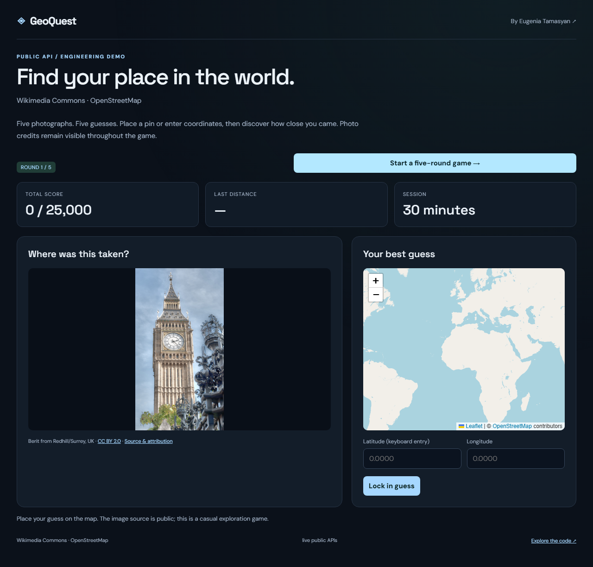
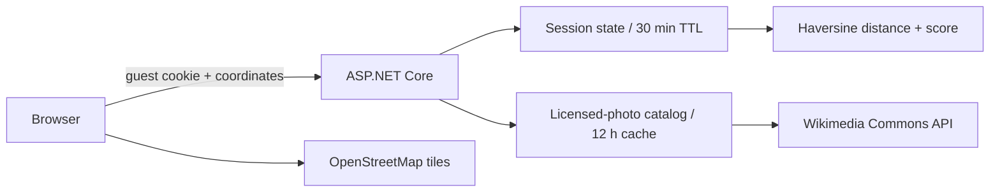

# GeoQuest

[](https://github.com/itinessity/geoquest/actions/workflows/ci.yml)


A five-round geography game built around real, geolocated Wikimedia Commons photographs. Guess on a map, reveal the answer and trace your journey.

**[Eugenia Tamasyan](https://itinessity.com)** · Senior .NET Backend Engineer · FinTech & Distributed Systems



## What you can try

- A catalog seeded from 36 landmarks across six continents; each available photograph must carry coordinates and an accepted reusable license.
- Five unique photographs per game, server-side Haversine distance and a 0–5,000 score per round.
- HTTP-only guest cookie, 30-minute sessions, coordinate bounds, round ownership and duplicate-answer rejection.
- A Leaflet map, keyboard coordinate entry, answer markers, final journey and visible photo attribution.
- A 12-hour in-memory catalog cache. Unavailable imagery produces an explicit error; there is no synthetic-photo fallback in live mode.

## Run locally

Requires the **.NET 10 SDK**. No provider account or API key is needed. Internet access is required for live data.

```bash
dotnet run --project src/App.csproj -c Release
```

Open **http://127.0.0.1:8080**. The application binds to loopback by default. To run several demos simultaneously, set a different `ASPNETCORE_URLS` per process. Each repository is independent.

Or use Docker:

```bash
docker compose up --build
```

The container also exposes only local port 8080 through Compose. It runs as the .NET image's non-root `app` user. Stop it with `docker compose down`; the named data volume persists.

## Walkthrough

1. Select **Start a five-round game**. The first catalog load queries Commons and can take a minute or more; subsequent games use the cache.
2. Inspect the photo, choose a point on the map or enter latitude/longitude, then lock in the guess.
3. Review the distance and server-calculated score. Continue through all five rounds to see the journey.
4. Start another game for a fresh selection.

## Architecture



The backend uses ASP.NET Core minimal APIs and built-in .NET libraries. The browser uses plain JavaScript and CSS; Node.js is needed only for browser tests. Provider/domain logic is separated from the HTTP endpoints in `src/`. The common infrastructure is intentionally small enough to inspect.

## API

| Endpoint | Behavior |
|---|---|
| `POST /api/games` | Start a five-round game and set its guest cookie |
| `GET /api/game` | Restore the current round without revealing future coordinates |
| `POST /api/guess` | `{ "roundId": "...", "latitude": 20, "longitude": 10 }` |
| `POST /api/next` | Advance only after an accepted answer |
| `GET /api/health` | Process status and an explicit live/fixture mode label |

The API accepts JSON request bodies and returns structured errors. Bodies are limited to 64 KB. Browser writes with a foreign Origin are rejected. The health endpoint reports process availability, not guaranteed provider availability.

## Verify

```bash
dotnet build src/App.csproj -c Release
dotnet run --project tests/Tests.csproj -c Release
python tests/integration.py
npm ci
npx playwright install chromium
npm run test:browser
```

Spatial edge cases (same point, poles, antipodes and antimeridian), guest ownership, invalid coordinates, tampered score input, repeated guesses and full five-round browser completion.

The C# checks are dependency-free executable assertions. HTTP tests launch an isolated process with a temporary data directory. Playwright covers the primary user flow and mobile overflow. CI runs all three layers on Ubuntu, builds a Release publish output and uses deterministic fixtures, so it does not depend on public-provider uptime.

Fixtures require **both** `ASPNETCORE_ENVIRONMENT=Testing` and `TestFixtures=true`. The UI labels fixture mode. Real-provider outages are never replaced by fixture data. Local live-provider and visual smoke checks are documented in [verification notes](docs/VERIFICATION.md).

## Boundaries and trade-offs

The catalog uses curated search centers, not a manually reviewed static set of 36 image files. A center may have no eligible photo; at least five are required to start. Photograph coordinates describe the geotagged camera location, which may differ from the landmark itself.

Guest games are held in memory and are lost on restart; the demo caps active sessions at 1,000. Public source URLs and photo credits may reveal the answer, so this is a casual exploration game rather than a competitive anti-cheat system. Starting a new game replaces the cookie's current game.

Commons files retain their individual licenses. The browser displays creator, license and source before and after a guess. This repository's MIT license does not relicense photos or map tiles. OSM tiles include visible attribution and are requested normally by the browser without bulk downloading. For substantial traffic, configure an appropriate tile provider in `src/wwwroot/app.js`.

This is a runnable local reference implementation, not a publicly hosted production service. Before deploying it for shared use, address the controls listed in [SECURITY.md](SECURITY.md). Original code is MIT-licensed; external data and vendored assets retain their own terms.

The screenshot’s photo and map credits are recorded in [screenshot attribution](docs/ATTRIBUTION.md).

## Data sources

- [MediaWiki geosearch API](https://www.mediawiki.org/wiki/API:Geosearch)
- [Commons reuse guidance](https://commons.wikimedia.org/wiki/Commons:Reusing_content_outside_Wikimedia)
- [OpenStreetMap tile usage policy](https://operations.osmfoundation.org/policies/tiles/)
- [Leaflet](https://leafletjs.com/) — vendored 1.9.4, BSD license retained in `src/wwwroot/vendor/LICENSE`

## About the author

I build .NET backends, trading integrations and reliable data workflows. See [itinessity.com](https://itinessity.com) for commercial experience and ways to work together.
